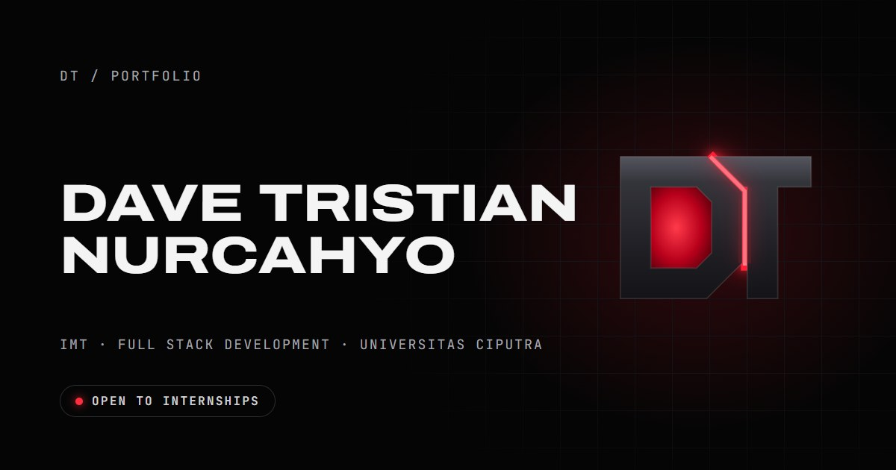

# Dave Tristian Nurcahyo · Portfolio



My one-page portfolio. The DT logo is a live 3D object: as you scroll, it turns, comes apart into an exploded view, and brings one piece forward for each chapter. **D** for Developer leads into my projects, **T** for Team into my organizations and kepanitiaan, and the glowing **core** ("always learning") into the about section. At the end it comes back together.

Built with React, TypeScript, Vite and React Three Fiber.

## Highlights

- **Scroll-driven 3D logo.** Every animation follows a single number, "story time", calculated from the scroll position. Stop scrolling and it stops; scroll back and it rewinds.
- **Works for everyone.** There's a reduced-motion mode (still poses with crossfades), a flat SVG logo for browsers without 3D, full keyboard navigation, and a 100 accessibility score in Lighthouse.
- **Easy to update.** All text lives in three content files, so editing doesn't touch layout code.
- **Light on devices.** The 3D code loads after the page, compiles its shaders in the background where the browser supports it, and only draws when something changes.
- **Tested.** 78 unit tests cover the content, the scroll choreography, the logo geometry and the components.

## Run it

You need [Node.js](https://nodejs.org) 20 or newer.

```bash
npm install
npm run dev
```

Then open http://localhost:5173. When you save a file, the browser updates instantly.

## Change the content

| To change… | Edit |
|---|---|
| Name, bio, spec sheet, contact links, footer | `src/content/profile.ts` |
| Projects | `src/content/projects.ts` |
| Organizations, kepanitiaan, teaching | `src/content/experience.ts` |
| Colors, fonts, spacing | `src/styles/tokens.css` |

**Photos.** Put your portrait at `public/images/portrait.jpg` (portrait shape, 4:5). Until it's there, a placeholder shows.

**Project images.** These are illustrations drawn in `design/project-art/`. After editing one, run `node scripts/render-images.mjs` to regenerate the `.webp` files.

**CV.** The "Download CV" button uses `public/cv.pdf`. That file is currently ignored by git, because the current CV includes a phone number (see `.gitignore`). Before publishing, remove that line from `.gitignore` so the CV gets committed. Otherwise, set `cvUrl: ''` in `profile.ts` to hide the button.

## Commands

| Command | What it does |
|---|---|
| `npm run dev` | Runs the site locally, with instant updates |
| `npm run build` | Builds the finished site into `dist/` |
| `npm run preview` | Serves the built site, to check it before publishing |
| `npm test` | Runs the unit tests |
| `npm run check` | Type-checks (TypeScript) and lints (Oxlint) |
| `npm run shots` | Screenshots the built site at laptop, tablet and phone sizes into `shots/` |
| `node scripts/render-images.mjs` | Renders the project illustrations, share image and home-screen icon |

## How it's organised

```
src/
  content/     the text: profile, projects, experience, chapters
  sections/    one file per chapter: Intro, About, Projects, Experience, Contact
  components/  reusable pieces: top bar, chapter list, cards, timeline, copy button…
  motion/      scroll → story time → logo poses (choreography.ts), plus the hooks that use it
  three/       the logo: flat SVG version, 3D version (React Three Fiber), labels, lighting
  brand/       the logo's geometry, shared by the flat and 3D versions
  styles/      design tokens and global styles
design/        sources for the illustrations and share images
docs/          design spec, build plan, and the code tour
scripts/       screenshot and image-rendering tools
```

## Publish it (Vercel)

1. Push this repository to GitHub.
2. Go to [vercel.com](https://vercel.com), choose **Add New → Project**, and import the repository. The defaults are right: framework Vite, build command `npm run build`, output folder `dist`.
3. After the first deploy, copy your site's address into `SITE_URL` in `vite.config.ts`, then commit and push. This makes link previews (WhatsApp, LinkedIn, Instagram) show the right image.

From then on, every push to `main` updates the live site.

## Learn how it works

[`docs/code-tour.md`](docs/code-tour.md) is a guided tour of this codebase for React beginners. It covers components, props, state, effects, context and refs, using this site's own code, and ends with step-by-step guides for common changes.

---

Designed and built by Dave Tristian · 2026
